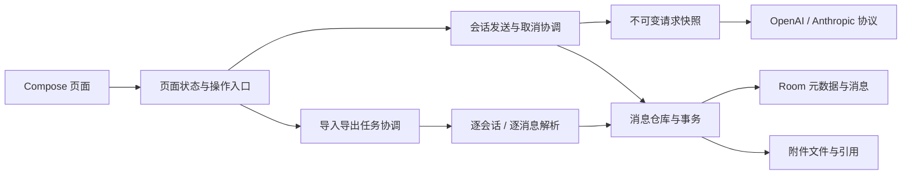

# SimpleChat 产品、架构与源码审查报告

审查日期：2026-11-16。对象：当前工作区（含本轮开始前已有的未提交修复）。版本标识仍为 1.1.3 / versionCode 16；本报告和本地构建不代表已经发布新版本。

后续更新（2026-11-17）：修复已纳入 v1.1.4 / versionCode 17；新增自动朗读、API 配置管理和正常渲染下的搜索渐隐高亮。最终发布内容见 [`../release-notes/RELEASE_NOTES_v1.1.4.md`](../release-notes/RELEASE_NOTES_v1.1.4.md)。下文保留审查时的测试计数和风险判断。

## 1. 结论

产品定位清楚：本地保存的 Android 长文本创作客户端，核心价值是历史素材可保留、上下文可控、消息可分支、长文可流畅阅读。主要问题不是缺功能，而是数据规模、失败恢复和任务生命周期尚未形成统一约束。当前实现里“每条消息都保留”的意图很强，但部分路径仍依赖“会话不大”“一次操作能顺利完成”“一个文件只属于一个会话”等隐含假设。

本轮最有价值的结果是把导入、导出、恢复做成真实数据闭环，并找出了只在大数据上出现的第二处 OOM：官方 ZIP 导入完整，导出的自家 ZIP 恢复却少一个会话。修复大字段重复复制后，192 MB Java 堆模拟器的完整闭环通过。发送路径同时补了写库前回读、并发快照、跨会话竞态、失败不清空草稿等保护，并通过 2100 万字符输入的发送与实际 Compose 页面联动测试。

建议下一阶段优先完成“有界读取、可恢复任务、操作状态机”，暂缓扩大功能面。本轮没有把尚未实现或没有充分验证的项目算作已解决。

## 2. 审查依据与边界

阅读了 README（中英）、TODO，以及 docs 中的 PRD、代码框架、数据模型、网络/API、Markdown、功能设计、工作流、文档规范，并参照 UI 设计和变更/实现记录相关章节。设计文档被当作产品约束与历史背景；代码、实测和用户反馈决定缺陷是否存在，文档中的“已解决”不作为验证证据。

重点对照了以下承诺：

- PRD：长文本连续创作、流畅优先、完全本地保存。
- 数据模型：分支不删历史、压缩只影响请求、数据库升级不得破坏性清库。
- 功能设计 §37：导入必须对账，不允许静默丢失整段会话。
- 工作流：单测、release/R8 构建与设备验证。

本轮修改保留了原有工作区改动，没有重置仓库；没有改动 `.dsh-acl-recovery/`。通过 ADB 使用独立的 emulator-5556，没有清空或停止用户正在测试的 emulator-5554。真实聊天数据只用于用户授权的本机压力测试，报告不包含标题、正文或 API Key。

## 3. 实测证据

### 3.1 真实官方 ZIP

源文件：用户授权的 `deepseek_data-2026-11-16.zip`，1,073,741,824 字节。测试设备 Android 34，应用 Java 堆上限 192 MB，测试开始时可用存储约 18 GB。

| 检查 | 结果 |
|---|---|
| 官方索引与会话文件 | 均为 2768 个，集合一致 |
| 首次空库增量导入 | 2768 个会话、71472 条消息、失败 0 |
| 重复增量导入 | 2768 个已存在，新增 0，失败 0 |
| 独立脚本与设备数据对账 | 会话缺失 0；消息缺失 0；额外消息 0 |
| 正文/思考 SHA-256 | 71472 条全部一致 |
| 原始图片 | 632 次引用，对应 566 个不同文件；566 个文件哈希均一致 |
| 完整 ZIP 导出 | 成功，最终一次为 1,149,942,826 字节 |
| 首次恢复测试 | 曾出现 2767/2768，1 个会话 OOM，明确报错而非成功 |
| 修复后恢复到另一份空数据库 | 2768 个会话、71472 条消息、失败 0 |
| 恢复后正文/思考哈希 | 缺失、额外、差异均为 0 |
| 恢复后图片 | 按备份中的每次引用生成文件，632 个；逐引用哈希多重集合完全一致 |

恢复后图片从 566 个物理文件变成 632 个是备份内联同一图片多次产生的副本，不是内容差异；文件去重仍是优化项。

这份测试验证了所有消息的正文/思考与被引用图片。它不代表 DeepSeek 所有元数据都已映射：搜索/读链过程、部分非图片附件仍有明确的格式支持限制，不能对外表述为“官方所有字段无损迁移”。

诊断产物保存在被 Git 忽略的 `build/import-audit/`：`stress-comparison.json`、`stress-image-comparison.json`、独立源哈希清单和设备哈希清单。部分产物由后一次恢复测试覆盖，报告已区分初次导入与恢复结果。

### 3.2 发送与页面

| 场景 | 结果/覆盖范围 |
|---|---|
| 连续 20 次发送/停止 | 实际经过请求序列化与本地模拟响应，全部通过 |
| 快速切换 30 次 | 最终会话正确，无未捕获异常 |
| 压缩上下文后发送 | 新用户输入实际出现在序列化请求中 |
| 超 CursorWindow 文本 | NUL、中文、emoji 经存储/导出/恢复保持一致 |
| 超长编辑 | 多 MB 消息新增版本后直接返回实体，不再整行回读 |
| 发送写库失败 | SQLite 触发器强制失败，不确认成功，不清空已提交草稿 |
| 超长正文布局 | 约 2100 万字符实际进入 Compose MessageList，分页正常，无布局 OOM |
| 超长消息搜索 | 命中接近末尾的关键词，目标页和可见命中节点出现 |
| 超长发送联动 | 同一 2100 万字符输入完成写库、真实 RequestBody 序列化、模拟回复、终写及页面布局，无闪退 |
| 网络阻塞取消 | OpenAI 和 Anthropic 两条流均在等待响应头时及时取消 |

网络测试使用本地拦截器，不调用用户的真实付费模型。它能验证客户端请求/状态/存储链路，不证明每个远端服务商的扩展字段兼容性，也不替代不同厂商真机验证。

### 3.3 自动化与构建

- JVM 单测：607 项，失败 0、错误 0、跳过 10。跳过项包含依赖本机特定素材的测试，不算已执行通过。
- Android 设备回归：导入、空/旧/断链会话、重复增量、搜索分支、超大行、导出恢复、发送/停止/切换、压缩后发送、全局 ID 冲突、同名保护、共享图片、预设链接、写库失败保护全部通过。
- Room schema 8→9：用旧 schema 创建数据库，执行真实迁移并通过 Room 校验；原附件引用保留，同一文件可登记两个会话。
- debug、androidTest、release 均构建成功；release 包执行了 R8 与 lintVital，APK 签名验证通过。独立模拟器安装 release 后冷启动成功。
- 本轮未覆盖所有 OEM、Android 8 真机、后台被杀恢复以及所有第三方文件提供器。

## 4. 已修复的主要问题

严重性口径：P0 为可能破坏已有用户数据；P1 为主要流程失败、闪退或不可恢复；P2 为体验或维护性问题。下面的严重性是修复前风险。

### R01 · P0 · 导入消息 ID 冲突可能覆盖其他会话

位置：[ChatDao.kt](../app/src/main/java/com/simplechat/app/db/ChatDao.kt)、[ChatRepository.kt](../app/src/main/java/com/simplechat/app/data/ChatRepository.kt)。

原来的流式写入仅检查当前会话 ID 集合，却使用全局主键上的 REPLACE/upsert。外来备份若复用了另一会话的消息 ID，可能把旧消息移动到新会话；旧非流式路径则静默跳过冲突消息。修复后统一使用 ABORT 插入和会话事务：冲突会话整体回滚、明确失败，原有消息保持不变。设备测试验证了原会话内容与失败会话不存在。

### R02 · P0 · 分叉会话共享图片，删除原会话会使副本丢图

位置：[Entities.kt](../app/src/main/java/com/simplechat/app/db/Entities.kt)、[AppDatabase.kt](../app/src/main/java/com/simplechat/app/db/AppDatabase.kt)、[ChatRepository.kt](../app/src/main/java/com/simplechat/app/data/ChatRepository.kt)。

图片路径被复制到新会话，引用表却以 path 单列为主键，分叉时也没有登记引用。修复为 `(path, conversationId)` 联合主键，显式迁移至 schema 9；分叉登记共享引用；删除文件前确认其他引用和历史消息均不再使用。后一个检查保护升级前漏登记的分叉。设备测试验证删除原会话后副本图片仍在，最后一个会话删除后文件才移除。

### R03 · P0 · 导入失败清理可能删除已有附件或漏清新文件

位置：[OwnBackupStream.kt](../app/src/main/java/com/simplechat/app/data/import/OwnBackupStream.kt)。

原实现把消息里所有 path 都当成本次生成；另一方面，图片已保存但后续字段解析失败时，还没来得及把路径加入清理集合。现只在新文件实际创建后立即登记，回滚只删除这些文件。测试覆盖“先读取已有路径，再创建图片，随后消息字段解码失败”。

### R04 · P1 · 自家备份恢复超大字段 OOM

位置：[OwnBackupStream.kt](../app/src/main/java/com/simplechat/app/data/import/OwnBackupStream.kt)。

压力测试真实复现：一个会话两条消息恢复失败，分配约 40 MB 数组时耗尽 192 MB 堆。原因是先捕获大字段的原始 JSON，再构建 JSON 元素，产生多份大文本。现对字符串字段直接解码，避免保留转义原文副本；随后全量恢复及 71472 条哈希校验通过。

### R05 · P1 · 点击发送时即清空输入，写库失败会丢稿

位置：[ChatScreen.kt](../app/src/main/java/com/simplechat/app/ui/chat/ChatScreen.kt)、[ChatViewModel.kt](../app/src/main/java/com/simplechat/app/ui/chat/ChatViewModel.kt)。

原 UI 调用异步 send 后立刻清空输入和草稿，无法知道消息是否落库。现通过 onPersisted 回调，只有用户消息事务成功后才清理提交内容；若用户期间修改了输入，也不会清掉新文本。编辑并重发同步采用该规则。强制写库失败测试验证回调未触发。

### R06 · P1 · 发送/编辑期间会话切换竞态

位置：[ChatViewModel.kt](../app/src/main/java/com/simplechat/app/ui/chat/ChatViewModel.kt)。

新建会话和读取会话都存在挂起点，返回后可能覆盖用户已经切换到的新页面。现从点击时捕获代次，创建/读取后核对代次；发送与编辑共享准备阶段互斥锁；过期任务不能改变新会话状态。startStream 先确认会话再递增流代次，避免旧操作使当前流失效。

### R07 · P1 · 大消息编辑后重新 SELECT 全行可在发送前闪退

位置：[ChatRepository.kt](../app/src/main/java/com/simplechat/app/data/ChatRepository.kt)。

新增变体后立即查回 `messages.findById()`，正文超过 CursorWindow 时触发异常。现复用已写入实体并补元数据，无需回读；设备多 MB 编辑测试通过。普通发送的相同问题已在此前工作区修复，本轮一并验证。

### R08 · P1 · 停止网络流可能等不到关闭 socket

位置：[CallCancellation.kt](../app/src/main/java/com/simplechat/app/net/CallCancellation.kt)、[CallCancellationTest.kt](../app/src/test/java/com/simplechat/app/net/CallCancellationTest.kt)。

阻塞读取本身阻止协程完成，而关闭请求却挂在完成回调中，可能形成等待。现用随父任务取消的子协程即时关闭 Call，两种协议共用这一机制；真实阻塞拦截器测试验证取消后任务及时结束。

### R09 · P1 · 回复终写失败被吞，页面误以为已保存

位置：[ChatViewModel.kt](../app/src/main/java/com/simplechat/app/ui/chat/ChatViewModel.kt)。

原终写使用 runCatching 但不处理失败。现保留显示内容，标明保存失败并提示先复制、检查存储。此修复提供可见失败，不等于已实现崩溃后自动重试落库。

### R10 · P1 · 压缩摘要写库异常可结束协程并残留工作状态

位置：[ChatViewModel.kt](../app/src/main/java/com/simplechat/app/ui/chat/ChatViewModel.kt)。

网络部分有异常处理，摘要持久化却在保护范围外。现处理数据库失败并在 finally 清理压缩状态；取消继续传播。此前工作区修正了摘要覆盖下标与过滤顺序，本轮设备测试确认新输入实际送达序列化请求。

### R11 · P1 · 各格式的导入写库规则不一致

位置：[ChatRepository.kt](../app/src/main/java/com/simplechat/app/data/ChatRepository.kt)。

旧适配器仍有“每批 50 个会话”的重试逻辑，缺少同名保护、消息计数对账、统一取消传播，并在会话链接之后写预设。现将已解析格式适配到 ImportSessionSource，复用单会话事务、计数校验、冲突保护与先预设后链接的顺序。同名但不同 ID 的两个导入会话都保留。

### R12 · P1 · 附件路径未限制在附件目录

位置：[AttachmentFiles.kt](../app/src/main/java/com/simplechat/app/data/AttachmentFiles.kt)。

备份字段直接拼入 File，包含 `../` 等路径可能访问或删除应用私有目录中的其他文件。现统一拒绝分隔符、绝对路径形式及 NUL，并核对 canonical parent。读取、导出、删除、大小查询都走同一解析函数；测试覆盖非法路径。

### R13 · P1 · 详细报告保存失败覆盖真正的导入结果

位置：[ChatRepository.kt](../app/src/main/java/com/simplechat/app/data/ChatRepository.kt)。

磁盘不足时数据事务可能已部分完成，但报告文件写失败又抛出异常，UI 只剩一句导入失败。现返回已知统计并附“详细报告未能保存”的提示；不会把报告文件写成功当作消息写成功。报告不是断点续传日志，见未完成项。

### R14 · P1 · 单会话 JSON 导出缺少其预设正文

位置：[ChatRepository.kt](../app/src/main/java/com/simplechat/app/data/ChatRepository.kt)。

原单会话导出带 enabledPresetIds 却不给 preset 定义，换机后人设可能丢失。现导出该会话关联的预设，避免携带无关预设。设备测试校验导出文件包含对应预设。

### R15 · P2 · 超长分页消息丢失操作入口与错误提示

位置：[MessageList.kt](../app/src/main/java/com/simplechat/app/ui/chat/MessageList.kt)、[PagedMessageBody.kt](../app/src/main/java/com/simplechat/app/ui/chat/PagedMessageBody.kt)。

此前新增的分页分支绕过普通气泡，长按菜单和错误说明没有渲染。现保留点击/长按/菜单与错误文案，并修正页码在文本变化后的边界行为。分页边界单测验证 emoji 不被切断、全文拼接无重复遗漏。超长文本当前使用纯文本分页，完整 Markdown 排版和来源时间线的产品一致性仍需后续完善。

### R16 · P2 · 完整成功判定没有涵盖缺图或索引未验证

位置：[ImportReport.kt](../app/src/main/java/com/simplechat/app/data/ImportReport.kt)。

原 complete 仅检查失败会话与会话数。现缺图片或索引明确未验证也不标为完整成功，并保留警告原因。首次扫描 OOM 也不再一律写成文件损坏。

### R17 · P2 · 导入源复制失败留下大缓存；自家恢复进度长时间不动

位置：[SettingsScreen.kt](../app/src/main/java/com/simplechat/app/ui/settings/SettingsScreen.kt)、[OwnBackupStream.kt](../app/src/main/java/com/simplechat/app/data/import/OwnBackupStream.kt)。

现复制失败/取消清理 staging 文件，复制循环响应协程取消，离开页面清理尚未消费的导入文件；自家备份按已完成会话更新进度。首遍扫描和单个超大会话的精细进度仍可改善。

### R18 · P2 · 网络错误响应无界读取及日志泄露；密钥缓存配对竞态

位置：[ErrorBody.kt](../app/src/main/java/com/simplechat/app/net/ErrorBody.kt)、[SecretBox.kt](../app/src/main/java/com/simplechat/app/data/SecretBox.kt)。

网关错误响应可能很大或回显请求文本。现最多读取 64 KiB，不再将完整错误体写入 logcat。API Key 解密缓存改为一次发布密文/明文二元组，避免两个 volatile 字段读到不同版本；首次密钥生成串行化。

## 5. 此前工作区修复，本轮确认有效的项目

这些工作在本轮开始前已存在，不能全部归为本轮新增：

- DeepSeek 两遍流式解析；正文不整会话建树；图片流式落盘；空会话保留；断链/环修复并记数；重复消息 ID 明确失败。
- 每个会话独立事务，消息批次限制为 32 条或约 512000 字符；结果含 expected、failures 和逐会话写入数量。
- JSON/ZIP 先生成文件，图片 Base64 流式编码；大行以 BLOB 切片无损读取，空 BLOB 允许 null。
- 搜索返回 messageId 并恢复对应分支；2026-11-17 已取消源文本模式，改为正常渲染下定位关键词并短暂渐隐高亮。
- SnapshotStateList 在主线程取快照后再后台建索引；流代次隔离；终写使用流本地内容，避免切换后读错可见列表。
- RequestBody 直接输出到 sink；上下文压缩修正覆盖顺序并检查存在用户消息。
- 本地崩溃报告、导入报告导出、生成与保存阶段进度条。
- 超长文本采用有界分页，避免一次挂接大量 Compose 节点。

## 6. 尚未闭合的风险与下一步

以下是源码审查发现的剩余问题，不标为已修复；其中“风险”不等于已证实是用户那台手机的闪退原因。

| 优先级 | 证据与问题 | 用户影响 | 建议与验收 |
|---|---|---|---|
| P1 | `loadActivePath()` 仍把当前分支全部正文加载为 List；分叉/删子树也会读全部消息 | 多条巨型消息叠加仍可能 OOM，页面分页只能限制布局 | 消息骨架与正文分页分离；删除只读 ID/parentId；两条以上超大正文实测 |
| P1 | `prepareRequestAttachments()` 读取每张原图并累计 Base64，请求模型持有所有图片 | 大量历史图片可在请求开始前造成高内存峰值 | 请求附件文件化/按需流式编码，按原始字节预算测试；不能静默去掉合法图片 |
| P1 | 导入/导出仍由 Settings 的 composition scope 持有 | 退后台/进程被杀无法可靠续做，结果文件不等于可恢复任务状态 | 持久任务状态、会话级 checkpoint、幂等重试、取消与明确恢复入口 |
| P1 | MERGE 只要会话 ID 已存在就整会话跳过 | 官方重新导出的同一会话增加了消息，用户以为“增量”能补齐，实际不会 | UI 改称“仅新增会话”，或设计基于来源消息 ID 的安全补齐模式与冲突预览 |
| P1 | `retryMessage`/`regenerate`/`continueMessage`/部分管理操作还缺少统一操作状态与异常出口 | 连续操作、删除后操作、磁盘故障时仍有未捕获异常/竞态风险 | 抽出按会话串行的操作入口；全链路 fault injection 与切换矩阵 |
| P1 | 源文件拷贝、临时文件、SQLite/WAL、图片和导出副本共同占空间，尚无预检/预留空间策略 | 空间不足仍会导致部分会话失败，本轮保证可见失败而非空间永远够用 | 导入前估算与实时空间监测；不足时停止继续写并保存可恢复清单 |
| P1 | Chatbox 适配器仍存在 `readBytes()` 与整包/整会话模型 | 大 Chatbox 数据不享受完整的官方包流式保障 | 将 Chatbox 解析端也迁到 ImportSessionSource；单会话/单图极限样本 |
| P2 | 完整备份模型未含草稿、压缩摘要；旧 String 导出 API 仍存在 | “完整备份”的边界不明确；内部误用旧 API 可重引 OOM | 明确备份清单；字段兼容扩展；删除无调用的整包 API |
| P2 | 官方搜索/读链步骤及部分非图片附件尚未映射 | 历史过程信息仍不完整 | 导入支持矩阵和条目级提示；保留原始未知片段或扩展映射 |
| P2 | 搜索使用 `instr(lower(content),…)`，每次输入触发查询，无全文索引 | 数百 MB 历史下扫描成本高；非 ASCII 大小写与 UI 匹配规则有差异 | 防抖、取消旧结果、统一标准化规则，再评估适合中文的索引方案 |
| P2 | 纯文本分页页码和长按操作已恢复，但长消息 Markdown/来源展示存在降级 | 长文阅读体验与普通消息不一致 | 提供可见的“分页/排版”说明、页内跳转和连续阅读设计 |
| P2 | 普通发送附件落盘后事务失败、旧版漏引用与删除单消息清理仍缺系统 GC | 长期积累孤儿文件占空间 | 以完整引用重建为前提做延迟 GC，避免启动时盲删合法图片 |
| P2 | `PresetDao.upsert` 使用 REPLACE，预设 ID 覆盖可能触发关联外键级联 | 导入已有 ID 预设可能影响本地旧会话挂载 | 改为真正 UPDATE/UPSERT 并验证旧会话链接；明确预设冲突策略 |
| P2 | 回应 EOF 与协议结束标记的语义尚未严格区分；流中 checkpoint 失败仍可能延迟到终写才提示 | 截断响应可能看起来完成；保存异常提示晚 | 协议结束状态测试、断流可恢复状态和独立持久化状态 |
| P2 | 同一 1.1.3/16 下有多份本地修复构建；文档有过期版本、测试数、模型术语 | 用户反馈无法准确对应代码；维护者误信旧保证 | 发布新构建标识、记录源码/产物哈希；设计文档区分当前规范与历史快照 |

## 7. 产品与架构建议

### 7.1 产品的优先级应调整

把“素材不丢、失败可恢复”提升到 P0 产品验收标准。导入成功应表达会话数、消息数、附件数与失败清单；“仅新增会话”与“补齐已有会话的新消息”必须是不同能力。覆盖同名属于有破坏性的恢复操作，建议先预览匹配对象和影响数量，默认使用新增。

大任务应有明确阶段：读取源文件 → 核对清单 → 写入 → 校验 → 完成/部分完成。进度不能单靠解析到文件末尾宣称成功，应在数据库事务提交和保存流关闭后完成。取消时说明已保留多少以及如何继续，不要求用户凭记忆检查历史列表。

### 7.2 保持轻量架构，同时收敛职责

无需为了审查引入 DI/Navigation 大框架。当前最需要的是拆分责任与稳定接口：

发送协调器持有“准备、已写入、请求中、终写、失败/停止”的状态，不让 UI 用一个 isStreaming 同时代表所有步骤。请求应由不可变的会话/配置/消息快照构造，避免挂起期间读到另一个会话的可变状态。导入导出协调器持有任务 ID、当前会话、计数和失败信息；页面只订阅进度。

### 7.3 数据层应有明确不变量

- 消息 ID 在数据库内唯一；来源 ID 冲突必须明确处理。
- 单会话导入事务要么全有、要么全无；事务外图片必须有创建记录与回滚策略。
- 一份图片可以被多个会话引用；最后一个引用消失才允许删除。
- “消息显示完成”和“消息保存成功”应区分。
- 列表布局、正文读取、请求组装都要有内存边界；不能只优化 ZIP 读取。
- 备份完整性必须通过恢复验证；只检查 ZIP 非零字节不够。

### 7.4 发布门槛

建议把本轮实际验证过的极限包和合成发送场景固定成发布回归，不再手写测试总数到 README。每次发布保存测试报告、schema 迁移结果、APK SHA-256 和构建标识。

下一轮验收至少覆盖：低堆/低存储组合、Android 8 与两个厂商真机、进程被杀后重试、多图长历史发送、超大活跃分支、语言切换与文件选择器返回。当前通过的 Android 34 模拟器结果不能替代这些矩阵。

## 8. 交付与注意事项

- 发布目标为 v1.1.4 / versionCode 17；签名 APK、校验值和发布内容以正式 Release 为准。
- 数据库升级为 schema 9，有显式 8→9 迁移；不要在含真实数据的设备上直接降级回只识别 schema 8 的旧包。
- 报告公开版本已移除个人本机路径和原始会话标题。真实归档、导出文件、逐消息哈希清单与本机测试产物均不提交。
